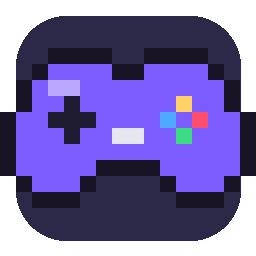

<p align="center"></p>

# Game Launcher

Déposez un jeu, cliquez sur **Jouer**. Jeux Windows (via Wine + DXVK), Nintendo DS (melonDS) et 3DS (Azahar).

## ⬇️ Télécharger
Dernière version : **[Releases](../../releases/latest)**

| Système | Fichier | Installation |
|---|---|---|
| macOS 14+ (Apple Silicon) | `GameLauncher-macOS.zip` | Décompresser, glisser dans *Applications*. 1er lancement : clic droit › **Ouvrir** (app non notariée). |
| Linux (Ubuntu, Fedora, Arch, SteamOS) | `gamelauncher-linux.tar.gz` | `tar xzf gamelauncher-linux.tar.gz && cd gamelauncher-linux && ./install.sh` |

## Fonctions
- Galerie locale par compte, ajout par glisser-déposer (.zip, .exe, .nds, .3ds…)
- Fenêtre de jeu contenue + barre : taille, commandes, puissance, **Quitter et sauvegarder**
- Sauvegardes automatiques ; restaurer une sauvegarde relance le jeu dessus
- Remappage clavier / manette (PlayStation, Xbox…) par jeu ; touches DS/3DS affichées
- Curseur de puissance (priorité + plafond d'images/s, sans couper le son)

## Compiler
```sh
./make-release.sh 0.3.0     # → release/GameLauncher-macOS.zip + release/gamelauncher-linux.tar.gz
```

⚠️ N'utilisez que des jeux et ROM que vous possédez légalement.
